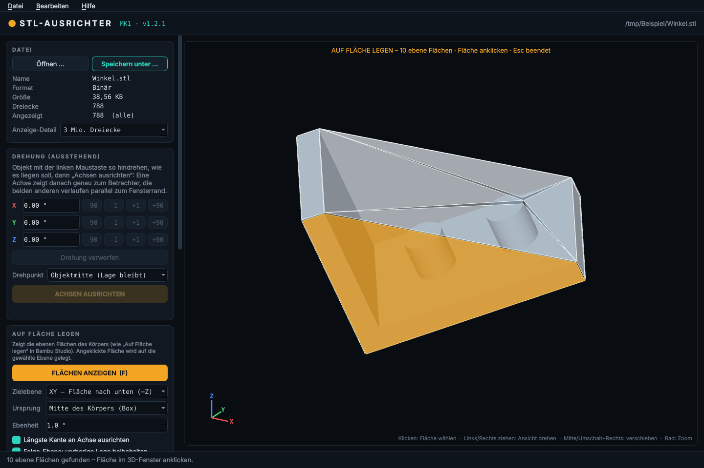

# STL-Ausrichter-MK1 · v1.2.1

STL-Dateien öffnen, frei im Raum drehen, die X/Y/Z-Achsen und -Ebenen gerade zur
angezeigten Lage ausrichten und die Datei **strukturgleich** wieder speichern –
auch bei STL-Dateien mit mehreren GB. Optional: Umwandlung in **STEP (.stp)** und
**Vereinfachen** als STL.


Das Programm ist **eine einzelne exe** – ohne daneben liegende Dateien oder Ordner.

## Bedienung

| Aktion | Wie |
|---|---|
| Datei öffnen | Ins Fenster ziehen · „Öffnen …“ (Strg+O) · im Explorer „Öffnen mit“ / Datei auf die exe ziehen |
| Objekt drehen | Linke Maustaste ziehen |
| Objekt um die Blickachse drehen | Strg + linke Maustaste |
| Ansicht drehen | Rechte Maustaste |
| Ansicht verschieben | Mittlere Maustaste oder Umschalt + rechte Maustaste |
| Zoom | Mausrad |
| Genau drehen | Winkelfelder X/Y/Z oder Knöpfe −90 / −1 / +1 / +90 |
| Achsen an Ansicht ausrichten | **ACHSEN AUSRICHTEN** (Strg+Enter) |
| Auf Fläche legen | **FLÄCHEN ANZEIGEN** (F) → Fläche anklicken · Esc beendet |
| Ursprung in Körpermitte | „Ursprung jetzt in Körpermitte setzen“ |
| Drehung verwerfen | Esc |
| Ausgerichtet speichern (verlustfrei) | „Speichern unter …“ (Strg+Umschalt+S) |
| STEP erzeugen (optional) | „Als STEP (.stp) speichern …“ |
| Vereinfachen (optional) | „Vereinfacht als STL speichern …“ |

Angezeigt werden:

* **Objekt-Ebenen XY / XZ / YZ** und **Objekt-Achsen X / Y / Z** (farbig, drehen mit dem Objekt)
* **Welt-Referenz** (graues Gitter und Rahmen, fest)

**ACHSEN AUSRICHTEN** richtet die Achsen an der aktuellen Ansicht aus: Das Objekt bleibt auf dem
Bildschirm genau so liegen, wie es angezeigt wird. Die Achse, die am ehesten zum Betrachter zeigt,
zeigt danach **exakt zum Betrachter** (sie erscheint als Punkt); die beiden anderen verlaufen
**exakt waagerecht bzw. senkrecht** zum Fensterrand. Die Ansicht springt dazu auf die passende
Standardansicht (z. B. von vorne), ohne dass sich das Bild ändert.
Zum Feinjustieren vorher: Strg + linke Maustaste dreht das Objekt um die Blickachse.

**Drehpunkt**
* *Objektmitte (Lage bleibt)* – das Objekt dreht um seine Mitte, seine Position im Raum bleibt erhalten.
* *Ursprung 0/0/0* – reine Drehung um den Koordinatenursprung.

## Auf Fläche legen (wie in Bambu Studio – für alle drei Ebenen)



1. **FLÄCHEN ANZEIGEN (F)** drücken. Wie bei „Auf Fläche legen“ in Bambu Studio werden alle
   ausreichend großen, ebenen Flächen des Körpers als weiße Flächen eingeblendet
   (berechnet über die konvexe Hülle; Hüllflächen mit gleicher Normale werden
   zusammengefasst, zu kleine Flächen und schmale Streifen verworfen, max. 254 Flächen).
   Die Fläche unter der Maus wird orange hervorgehoben.
2. **Zielebene** wählen: XY, XZ oder YZ – jeweils mit Richtung (z. B. „XY – Fläche nach unten (−Z)“
   entspricht dem Original: die Fläche liegt auf dem Druckbett).
3. Fläche **anklicken** – das Objekt wird so gedreht, dass die Fläche auf der gewählten Ebene liegt.
4. Danach wird der **Ursprung 0/0/0 in die Mitte des Körpers** gesetzt – wahlweise Mitte der
   Begrenzungsbox oder Volumenschwerpunkt. Berechnet wird das **exakt über alle Dreiecke der
   Datei** (nicht nur über die Anzeige).

Zusätzliche Optionen:

* **Längste Kante an Achse ausrichten** – dreht in der Ebene zusätzlich so, dass die längste
  Kante der Fläche parallel zur nächstliegenden Achse liegt (bei kantigen Teilen sind damit alle
  drei Achsen auf einen Klick gerade).
* **Folge-Ebene** – nach dem ersten Legen kann eine Seitenfläche auf eine andere Ebene gelegt
  werden (z. B. erst Boden auf XY, dann Seite auf XZ). Das Objekt dreht dann nur noch um die
  bereits festgelegte Achse, die erste Fläche bleibt liegen.
* **Ebenheit** – Toleranz in Grad, ab wann leicht unebene Bereiche (z. B. bei 3D-Scans) noch als
  eine Fläche gelten.
* Die Normale der gewählten Fläche wird über alle darauf liegenden Punkte nachgerechnet – bei
  CAD-Dateien liegt die Fläche danach exakt in der Ebene.

Auch das Legen ist verlustfrei: Es werden nur Drehung und Verschiebung gesetzt, gespeichert wird
wie gewohnt mit „Speichern unter …“.

## Ausrichten & Speichern – immer ohne Komprimierung

* Die Datei wird **nie komplett in den Arbeitsspeicher geladen**, sondern blockweise gelesen
  und geschrieben. Für die Darstellung wird bei sehr großen Dateien nur jedes n-te Dreieck
  angezeigt (einstellbar: „Anzeige-Detail“). **Gespeichert werden immer alle Dreiecke.**
* **Binär-STL:** 80-Byte-Header, Dreiecksanzahl, Reihenfolge der Dreiecke, das
  2-Byte-Attribut jedes Dreiecks (z. B. Farbinformationen) und evtl. angehängte Daten werden 1:1
  übernommen. Nur Eckpunkte und Normalen werden gedreht → **Dateigröße bytegenau identisch,
  keine Komprimierung, keine Vereinfachung**.
* **ASCII-STL:** Jede Zeile bleibt erhalten, Zahlen werden im selben Format (Nachkommastellen,
  Exponentenschreibweise) geschrieben; Längenunterschiede (z. B. neues Minuszeichen) werden über
  Leerzeichen ausgeglichen → Dateigröße ebenfalls identisch.
* Gerechnet wird in doppelter Genauigkeit. Drehungen um exakt 90° sind verlustfrei.
* Es wird zuerst in `<Ziel>.teil` geschrieben und erst am Ende umbenannt – bei Abbruch oder
  Fehler bleibt die Zieldatei unangetastet. Vor dem Speichern wird der freie Speicherplatz geprüft.

## Optional: STEP-Umwandlung und Vereinfachen

Beide Funktionen sind **nur Zusatzoptionen** und verwenden die aktuelle Ausrichtung.
Die Originaldatei wird dabei nicht verändert.

* **Als STEP speichern** – Flächenrückführung aus dem Projekt *STL-STEP-Konverter-MK1*
  (`converter.py`): Dreiecksnetz → Volumenkörper, ebene Flächen zusammenführen, volle
  Zylinder/Kugeln durch echte Flächen ersetzen, optional Scan-Oberflächen als NURBS glätten.
  Reicht der Arbeitsspeicher nicht, vereinfacht der Konverter automatisch weiter.
* **Vereinfacht als STL speichern** – reduziert die Anzahl der Dreiecke (Quadric-Dezimierung)
  und glättet optional. Jeder Körper der Datei wird einzeln vereinfacht; würde ein Körper dabei
  zerstört (verschwindet oder ändert seine Maße um mehr als 1 %), bleibt er unverändert.
  Dieselbe Vorab-Vereinfachung wird auch vor der STEP-Umwandlung genutzt.
* Einstellungen: *Vereinfachung* (Ziel-Dreiecke in %; bei STEP 100 % = keine Vorab-Vereinfachung),
  *Glättung* (0–10 Durchgänge), STEP-Optionen.
* Die Aufträge laufen in einem eigenen Prozess: jederzeit abbrechbar, und selbst ein
  Speicherengpass beendet nur den Auftrag, nicht das Programm.
* Hinweis: Für STEP und Vereinfachen wird das Netz vollständig geladen – bei Dateien mit
  mehreren GB braucht das entsprechend viel Arbeitsspeicher und Zeit.

## Build

GitHub Actions (`.github/workflows/build-exe.yml`) baut bei jedem Push auf `main`
eine **einzelne** `STL-Ausrichter-MK1-v<Version>.exe` (PyInstaller `--onefile`) und legt
ein Release an (exe direkt + als ZIP). Die Version steht in `version.py`.

Da alles in einer Datei steckt, entpackt die exe beim Start ihre Bibliotheken kurz in den
Temp-Ordner (wird beim Beenden automatisch entfernt). Der erste Start dauert deshalb
einige Sekunden länger.

Lokal starten:

```
pip install -r requirements.txt
python main.py [datei.stl]
```

## Versionen

* **1.2.1** – „Achsen ausrichten“ richtet die Achsen jetzt an der Ansicht aus (eine Achse exakt
  zum Betrachter, die anderen parallel zum Fensterrand); Kamera mit Drehung um die Blickachse.
* **1.2.0** – „Auf Fläche legen“ (wie Bambu Studio) für XY/XZ/YZ mit Folge-Ebene,
  Kantenausrichtung und Ursprung in Körpermitte (Box oder Volumenschwerpunkt, exakt).
* **1.1.0** – Eine einzelne exe; STEP-Umwandlung (aus STL-STEP-Konverter-MK1) und Vereinfachen
  als Option; Screenshot im README.
* **1.0.0** – Erstversion: Ansicht, Drehen, Achsen ausrichten, verlustfreies Speichern.
