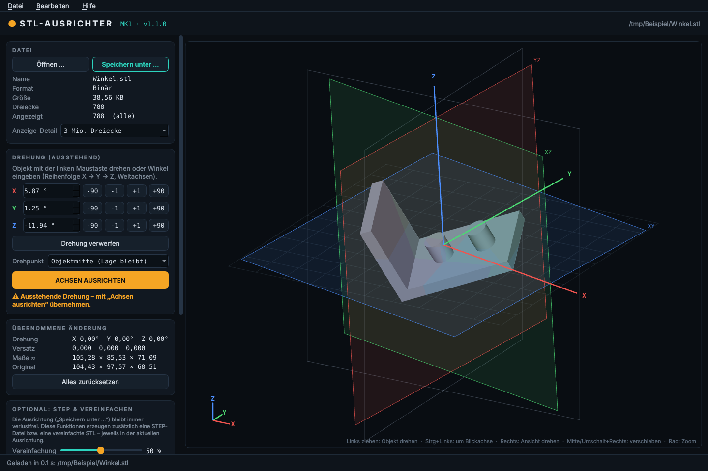

# STL-Ausrichter-MK1 · v1.1.0

STL-Dateien öffnen, frei im Raum drehen, die X/Y/Z-Achsen und -Ebenen gerade zur
angezeigten Lage ausrichten und die Datei **strukturgleich** wieder speichern –
auch bei STL-Dateien mit mehreren GB. Optional: Umwandlung in **STEP (.stp)** und
**Vereinfachen** als STL.



Das Programm ist **eine einzelne exe** – ohne daneben liegende Dateien oder Ordner.

## Bedienung

| Aktion | Wie |
|---|---|
| Datei öffnen | Ins Fenster ziehen · „Öffnen …“ (Strg+O) · im Explorer „Öffnen mit“ / Datei auf die exe ziehen |
| Objekt drehen | Linke Maustaste ziehen |
| Objekt um die Blickachse drehen | Strg + linke Maustaste |
| Ansicht drehen | Rechte Maustaste |
| Ansicht verschieben | Mittlere Maustaste oder Umschalt + rechte Maustaste |
| Zoom | Mausrad |
| Genau drehen | Winkelfelder X/Y/Z oder Knöpfe −90 / −1 / +1 / +90 |
| Lage übernehmen | **ACHSEN AUSRICHTEN** (Strg+Enter) |
| Drehung verwerfen | Esc |
| Ausgerichtet speichern (verlustfrei) | „Speichern unter …“ (Strg+Umschalt+S) |
| STEP erzeugen (optional) | „Als STEP (.stp) speichern …“ |
| Vereinfachen (optional) | „Vereinfacht als STL speichern …“ |

Angezeigt werden:

* **Objekt-Ebenen XY / XZ / YZ** und **Objekt-Achsen X / Y / Z** (farbig, drehen mit dem Objekt)
* **Welt-Referenz** (graues Gitter und Rahmen, fest)

Nach „Achsen ausrichten“ liegen Objekt-Ebenen und Welt-Referenz deckungsgleich:
die soeben angezeigte Lage ist jetzt die neue Grundlage des Objekts.

**Drehpunkt**
* *Objektmitte (Lage bleibt)* – das Objekt dreht um seine Mitte, seine Position im Raum bleibt erhalten.
* *Ursprung 0/0/0* – reine Drehung um den Koordinatenursprung.

## Ausrichten & Speichern – immer ohne Komprimierung

* Die Datei wird **nie komplett in den Arbeitsspeicher geladen**, sondern blockweise gelesen
  und geschrieben. Für die Darstellung wird bei sehr großen Dateien nur jedes n-te Dreieck
  angezeigt (einstellbar: „Anzeige-Detail“). **Gespeichert werden immer alle Dreiecke.**
* **Binär-STL:** 80-Byte-Header, Dreiecksanzahl, Reihenfolge der Dreiecke, das
  2-Byte-Attribut jedes Dreiecks (z. B. Farbinformationen) und evtl. angehängte Daten werden 1:1
  übernommen. Nur Eckpunkte und Normalen werden gedreht → **Dateigröße bytegenau identisch,
  keine Komprimierung, keine Vereinfachung**.
* **ASCII-STL:** Jede Zeile bleibt erhalten, Zahlen werden im selben Format (Nachkommastellen,
  Exponentenschreibweise) geschrieben; Längenunterschiede (z. B. neues Minuszeichen) werden über
  Leerzeichen ausgeglichen → Dateigröße ebenfalls identisch.
* Gerechnet wird in doppelter Genauigkeit. Drehungen um exakt 90° sind verlustfrei.
* Es wird zuerst in `<Ziel>.teil` geschrieben und erst am Ende umbenannt – bei Abbruch oder
  Fehler bleibt die Zieldatei unangetastet. Vor dem Speichern wird der freie Speicherplatz geprüft.

## Optional: STEP-Umwandlung und Vereinfachen

Beide Funktionen sind **nur Zusatzoptionen** und verwenden die aktuelle Ausrichtung.
Die Originaldatei wird dabei nicht verändert.

* **Als STEP speichern** – Flächenrückführung aus dem Projekt *STL-STEP-Konverter-MK1*
  (`converter.py`): Dreiecksnetz → Volumenkörper, ebene Flächen zusammenführen, volle
  Zylinder/Kugeln durch echte Flächen ersetzen, optional Scan-Oberflächen als NURBS glätten.
  Reicht der Arbeitsspeicher nicht, vereinfacht der Konverter automatisch weiter.
* **Vereinfacht als STL speichern** – reduziert die Anzahl der Dreiecke (Quadric-Dezimierung)
  und glättet optional. Jeder Körper der Datei wird einzeln vereinfacht; würde ein Körper dabei
  zerstört (verschwindet oder ändert seine Maße um mehr als 1 %), bleibt er unverändert.
  Dieselbe Vorab-Vereinfachung wird auch vor der STEP-Umwandlung genutzt.
* Einstellungen: *Vereinfachung* (Ziel-Dreiecke in %; bei STEP 100 % = keine Vorab-Vereinfachung),
  *Glättung* (0–10 Durchgänge), STEP-Optionen.
* Die Aufträge laufen in einem eigenen Prozess: jederzeit abbrechbar, und selbst ein
  Speicherengpass beendet nur den Auftrag, nicht das Programm.
* Hinweis: Für STEP und Vereinfachen wird das Netz vollständig geladen – bei Dateien mit
  mehreren GB braucht das entsprechend viel Arbeitsspeicher und Zeit.

## Build

GitHub Actions (`.github/workflows/build-exe.yml`) baut bei jedem Push auf `main`
eine **einzelne** `STL-Ausrichter-MK1-v<Version>.exe` (PyInstaller `--onefile`) und legt
ein Release an (exe direkt + als ZIP). Die Version steht in `version.py`.

Da alles in einer Datei steckt, entpackt die exe beim Start ihre Bibliotheken kurz in den
Temp-Ordner (wird beim Beenden automatisch entfernt). Der erste Start dauert deshalb
einige Sekunden länger.

Lokal starten:

```
pip install -r requirements.txt
python main.py [datei.stl]
```

## Versionen

* **1.1.0** – Eine einzelne exe; STEP-Umwandlung (aus STL-STEP-Konverter-MK1) und Vereinfachen
  als Option; Screenshot im README.
* **1.0.0** – Erstversion: Ansicht, Drehen, Achsen ausrichten, verlustfreies Speichern.
